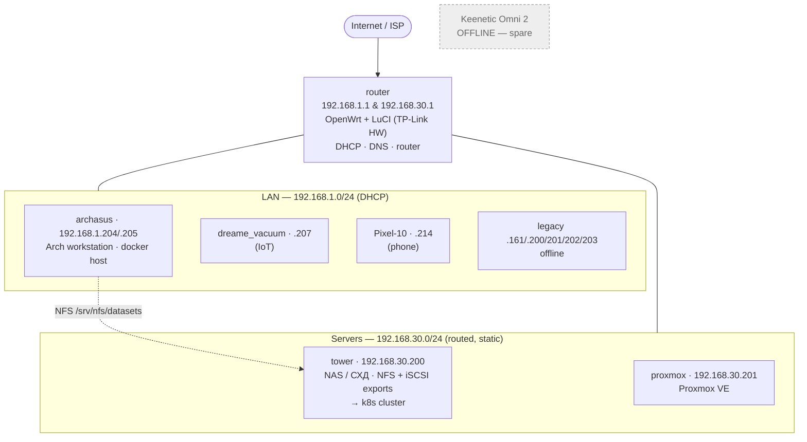

# Home network — `tower_cloud`

Working notes for developing the local network infrastructure. Written to be read
by both humans and AI agents.

- **Machine-readable source of truth:** [`inventory.yaml`](inventory.yaml)
- **Recon commands:** [`../../scripts/recon.sh`](../../scripts/recon.sh)
- **Change log / observations:** [`CHANGELOG.md`](CHANGELOG.md)

> Verified **2026-10-12** from `archasus`. Everything below is observed, not
> assumed. Anything uncertain is marked ❓ and listed under *Open questions*.

## Topology



```
                         ┌──────────────────────────────┐
        Internet ────────▶│ router  192.168.1.1 / .30.1  │
                         │ OpenWrt · LuCI · dropbear    │
                         └───────┬───────────────┬──────┘
                                 │               │
            192.168.1.0/24 ──────┘               └────── 192.168.30.0/24
            (LAN, DHCP)                                       (servers, routed)

         archasus .204/.205 ───────────┐
         vacuum .207                   │  NFS 2049
         Pixel-10 .214                 ▼
         (legacy .161/.200–.203 offline)   tower .200   ── NAS/media
                                           proxmox .201 ── hypervisor
```

## Subnets

| Subnet | Purpose | Gateway | DHCP |
|---|---|---|---|
| `192.168.1.0/24` | LAN — workstations, phones, IoT | `192.168.1.1` | yes |
| `192.168.30.0/24` | Server segment (NAS + hypervisor) | `192.168.30.1` | no (static) |
| `fde7:823d:5636::/64` | IPv6 ULA advertised by the router | `fde7:823d:5636::1` | RA |

The server subnet is **routed, not bridged** — traffic from the LAN goes
through the router (`traceroute` shows one hop to `192.168.30.200`).

## Hosts at a glance

| Host | IP | Role | Status |
|---|---|---|---|
| router | `192.168.1.1`, `192.168.30.1` | OpenWrt gateway/DHCP/DNS | up |
| archasus | `192.168.1.204` + `.205` | Arch workstation, docker host | up |
| tower | `192.168.30.200` (`tower.lan`) | NAS / media / object storage | up |
| proxmox | `192.168.30.201` | Proxmox VE hypervisor | up |
| dreame_vacuum | `192.168.1.207` | robot vacuum (IoT) | up |
| Pixel-10 | `192.168.1.214` | phone | up |
| keenetic-omni-2 | — | spare router | **offline** |

Full detail (services, MACs, notes): [`inventory.yaml`](inventory.yaml).

## Services

### tower — `192.168.30.200`
- `22` ssh · `80` nginx (webserver; Jellyfin proxy site disabled)
- `2049` NFSv4 — exports `/mnt/raid1/k8s-nfs` and `/mnt/raid1/share/downloads` → k8s
- `3260` iSCSI (LIO target `iqn.2026-10.lan.tower:k8s`)
- Media/identity workloads now run in the cluster (see `../../` PLAN / k8s/)

### k8s cluster — `10.10.120.101-104` (VLAN 120)
- `*.k8s.lan` via ingress-nginx on all nodes — e.g. `https://jellyfin.k8s.lan`,
  `https://transmission.k8s.lan`, `https://keycloak.k8s.lan`, `https://vault.k8s.lan`

### proxmox — `192.168.30.201`
- `22` ssh · `111` rpcbind · `3128` SPICE proxy · `8006` Proxmox web UI

### router — `192.168.1.1`
- `22` dropbear ssh · `80`/`443` LuCI

## Common access

```bash
ssh root@192.168.1.1            # router (OpenWrt)          [creds: external]
ssh tower                        # NAS  (resolves to tower.lan → 192.168.30.200)
ssh arch@192.168.30.201          # proxmox
https://jellyfin.k8s.lan/        # Jellyfin (k8s, ns media)
https://192.168.30.201:8006/     # Proxmox UI
# NFS export is consumed by the k8s cluster, not mounted on workstations
```

Credentials are **not** stored in this repo. Keep them in your password manager
and reference them here by name only.

## Recon

```bash
scripts/recon.sh                 # read-only report of the current network
scripts/recon.sh --host booth    # limit port scan to one host
```

The script performs no writes and needs no privileges. It re-prints the facts
that populate `inventory.yaml` so the file can be kept honest.

## Open questions

See `open_questions:` in [`inventory.yaml`](inventory.yaml). Highlights:

1. Confirm the two servers are **tower** + **proxmox**.
2. Goal / scope of the `tower_cloud` project?
3. Planned role of the offline **Keenetic Omni 2**?
4. Why does `archasus` hold two IPv4 leases (`.204` **and** `.205`) on one NIC?
5. What are the `biqu*` hosts (`.161/.202/.203`) — 3D printer controllers?
