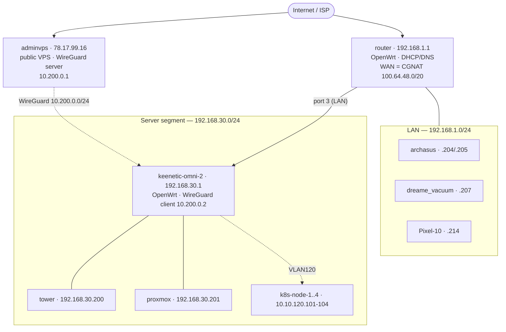

# Home network — `tower_cloud`

Working notes for developing the local network infrastructure. Written to be read
by both humans and AI agents.

- **Machine-readable source of truth:** [`inventory.yaml`](inventory.yaml)
- **Recon commands:** [`../../scripts/recon.sh`](../../scripts/recon.sh)
- **Change log / observations:** [`CHANGELOG.md`](CHANGELOG.md)

> Verified **2026-10-14** from `archasus`. Everything below is observed, not
> assumed. Anything uncertain is marked ❓ and listed under *Open questions*.

## Topology

The home WAN is **CGNAT** (main router `eth0.2` = `100.64.48.134/20`), so there
is **no public IPv4** and inbound port-forwarding is impossible. External access
therefore runs through a public relay: a VPS (**`adminvps`**) holds a
**WireGuard** tunnel to the **Keenetic Omni II** (reflashed to OpenWrt), which
is the router for the server segment.



```
Internet/ISP (CGNAT) ──── adminvps 78.17.99.16 (WG server 10.200.0.1)
        │                         ┊  WireGuard 10.200.0.0/24
        │                         ┊
   router 192.168.1.1             ┊
        │ LAN 192.168.1.0/24      ┊
        └─ port 3 (LAN) ── keenetic-omni-2 192.168.30.1 (WG client 10.200.0.2)
                              ├── 192.168.30.0/24 : tower .200, proxmox .201
                              └── VLAN120 10.10.120.0/24 : k8s-node-1..4
```

External data path (front end **live**; domain **`metoda.cc`**):
`Internet → adminvps:443 (**Traefik** + Let's Encrypt) → WireGuard → Keenetic →
ingress-nginx (VLAN120) → k8s apps`.

**DNS:** `metoda.cc` is delegated to Timeweb's nameservers (`ns1/2.timeweb.ru`,
`ns3/4.timeweb.org`). Since 2026-10-19 the zone is visible to the Timeweb Cloud
API (zone id `25051187-metoda.cc`) and its `A` records are managed as code in
`tofu/dns` (ADR-0005): `cloud.` / `auth.` / `*.` — plus the apex and `www` — →
`adminvps` (`78.17.99.16`). TLS via Let's Encrypt **HTTP-01** (Traefik on
`adminvps:80`; no wildcard certificate yet).

## Subnets

| Subnet | Purpose | Gateway | DHCP |
|---|---|---|---|
| `192.168.1.0/24` | LAN — workstations, phones, IoT | `192.168.1.1` (router) | yes |
| `192.168.30.0/24` | Server segment (Keenetic LAN) | `192.168.30.1` (Keenetic) | yes |
| `10.10.120.0/24` | k8s nodes (VLAN 120, isolated L2) | `10.10.120.1` (Keenetic) | ❓ static |
| `10.200.0.0/24` | WireGuard uplink (`adminvps` ↔ Keenetic) | `10.200.0.1` (adminvps) | no |
| `fde7:823d:5636::/64` | IPv6 ULA advertised by the router | `fde7:823d:5636::1` | RA |

The server segment is no longer on the main router: the Keenetic Omni II owns it
(`br-lan`). proxmox keeps a **VLAN30-tagged** management interface (`vmbr0.30`)
which the Keenetic bridges into `192.168.30.0/24`; k8s stays in **VLAN120** as a
separate network.

## Hosts at a glance

| Host | IP | Role | Status |
|---|---|---|---|
| router | `192.168.1.1` | OpenWrt gateway/DHCP/DNS (WAN = CGNAT) | up |
| adminvps | `78.17.99.16` | public VPS · WireGuard server · proxy box | up |
| keenetic-omni-2 | `192.168.30.1` | OpenWrt server router · WG client | up |
| archasus | `192.168.1.204` + `.205` | Arch workstation, docker host | up |
| tower | `192.168.30.200` | NAS / media / object storage | up |
| proxmox | `192.168.30.201` | Proxmox VE hypervisor | up |
| dreame_vacuum | `192.168.1.207` | robot vacuum (IoT) | up |
| Pixel-10 | `192.168.1.214` | phone | up |
| k8s-node-1..4 | `10.10.120.101-104` | Kubernetes (VLAN 120) | up |

Full detail (services, MACs, notes): [`inventory.yaml`](inventory.yaml).

## Services

### adminvps — `78.17.99.16` (public)
- `22` ssh · `1080` danted SOCKS · `443/udp` hysteria · `51820/udp` WireGuard
- `80`/`443` tcp **Traefik** (Let's Encrypt HTTP-01, Docker Compose) — fronts
  `cloud.` / `auth.` → home ingress-nginx over WireGuard

### keenetic-omni-2 — `192.168.30.1` (OpenWrt 23.05.3)
- `22` dropbear · `80`/`443` LuCI
- WireGuard **client** to `adminvps` (`10.200.0.2`)
- Switch: port 0 = WAN, ports 1-4 = LAN; port 3 = proxmox (VLAN30+VLAN120 trunk)

### tower — `192.168.30.200`
- `22` ssh · `80` nginx · `2049` NFS · `3260` iSCSI · `3900` Garage S3 · `5432` Postgres
- Media/identity workloads run in the cluster (see `../../` PLAN / k8s/)

### proxmox — `192.168.30.201`
- `22` ssh · `111` rpcbind · `3128` SPICE proxy · `8006` Proxmox web UI

### k8s cluster — `10.10.120.101-104` (VLAN 120)
- `*.k8s.lan` via ingress-nginx on all nodes — e.g. `https://jellyfin.k8s.lan`,
  `https://opencloud.k8s.lan`, `https://vault.k8s.lan`; Keycloak's canonical host
  is the public `auth.metoda.cc` (split-horizon → ingress-nginx internally)
- Reachable from `adminvps` over the WireGuard tunnel (ingress, nodes, API `:6443`)

### router — `192.168.1.1`
- `22` dropbear ssh · `80`/`443` LuCI

## Common access

```bash
ssh root@192.168.1.1            # router (OpenWrt)          [creds: external]
ssh tower                       # NAS — .200 (DHCP reservation on the Keenetic)
ssh arch@192.168.30.201         # proxmox
ssh arch@78.17.99.16            # adminvps (public VPS)
ssh root@192.168.1.216          # keenetic-omni-2 (via its WAN; LuCI on .30.1)
https://jellyfin.k8s.lan/       # Jellyfin (k8s, ns media)
```

Credentials are **not** stored in this repo. Keep them in your password manager
and reference them here by name only.

## Recon

```bash
scripts/recon.sh                 # read-only report of the current network
scripts/recon.sh --host booth    # limit port scan to one host
```

The script performs no writes and needs no privileges. It re-prints the facts
that populate `inventory.yaml` so the file can be kept honest.

## Open questions

See `open_questions:` in [`inventory.yaml`](inventory.yaml). Highlights:

1. **`metoda.cc`** — A records `cloud` / `auth` / `*` (plus apex and `www`) are
   live, pointing at `adminvps`, and managed as code in `tofu/dns` (ADR-0005).
   Consider DNS-01 + a wildcard certificate now that the zone is API-managed.
2. Publish/secure the public apps: Keycloak's `KC_HOSTNAME` is now
   `https://auth.metoda.cc` and split-horizon DNS is codified in `router_openwrt`
   (dnsmasq answers `auth.metoda.cc` with the ingress-nginx node IPs) — **not yet
   applied**. Which services are public vs VPN-only?
3. How to manage the **Keenetic Omni II** (OpenWrt server router) by IaC?
4. Move the k8s node DHCP reservations off the main router onto the Keenetic?
5. `keycloak` / `vault` are not answering in the cluster — bring them up.
6. Why does `archasus` hold two IPv4 leases (`.204` **and** `.205`) on one NIC?
7. What are the `biqu*` hosts (`.161/.202/.203`) — 3D printer controllers?
